# MR Training — The Operating System for Sports Coaching

MR Training es una plataforma SaaS de alto rendimiento que unifica el ecosistema del entrenamiento deportivo y la preparación física: entrenadores (coaches), atletas, academias, clubes deportivos, nutricionistas y fisioterapeutas.

---

## 🏛 Arquitectura del Sistema

Monorepo organizado con pnpm workspaces:

```
mr-training/
├── apps/
│   ├── web/          # Next.js 14+ (App Router) - Panel Coach, Landing & Super Admin
│   ├── mobile/       # React Native CLI (iOS & Android) - App para Atletas
│   ├── api/          # Go 1.25 (Fiber) - Backend principal (Única Fuente de Verdad)
│   └── rules/        # 16 Especificaciones y Reglas de Arquitectura obligatorias
├── packages/
│   ├── shared/       # DTOs y tipos compartidos
│   ├── ui/           # Sistema de diseño (Tailwind CSS 3.4+)
│   └── config/       # Configuraciones base (ESLint, TS, Tailwind)
└── docs/             # Specs, planes de ejecución y documentación
```

---

## 💳 Modelo de Planes y Suscripciones (2 Niveles)

MR Training implementa un modelo de facturación y cuotas desacoplado en dos capas estrictamente aisladas:

```mermaid
flowchart TD
    subgraph Nivel1["Nivel 1: Plataforma SaaS B2B (Super Admin → Coach)"]
        SA["Super Admin (/admin/plans)"] -->|Define precio y max_athletes| GlobalPlans["Planes de Plataforma (plans)"]
        GlobalPlans -->|GET /public/plans| CoachLanding["Landing & Registro Coach"]
        CoachLanding -->|Registro| Trial["Prueba Gratis de 7 Días (sin tarjeta)"]
        Trial -->|Vence período o Upgrade| PaidSub["Suscripción Activa Coach"]
        PaidSub -->|Aumenta de inmediato| Capacidad["Capacidad max_athletes (coach_capacity.go)"]
    end

    subgraph Nivel2["Nivel 2: Servicios de Coaching B2C (Coach → Atleta)"]
        Coach["Coach (/coach/planes)"] -->|Crea planes y precios propios| CoachPlans["Catálogo del Coach (coach_id)"]
        CoachPlans -->|GET /public/coaches/:id/plans| AthleteView["Landing y App del Atleta"]
        AthleteView -->|Solo planes activos de SU coach| AthleteSub["Membresía del Atleta"]
        AthleteSub -->|Suma a AthletesCount| CheckLimit{"AthletesCount < max_athletes?"}
        CheckLimit -->|Sí| LinkOK["Atleta Activo en Roster"]
        CheckLimit -->|No| Block["Bloqueo en handlers/invite.go"]
    end
```



### 1. Nivel 1 — Planes de Plataforma (Super Admin $\rightarrow$ Coach)
- **Gestión centralizada:** El Super Admin gestiona los planes de la plataforma desde `/admin/plans` (vía `GET/POST/PUT /api/v1/admin/plans`).
- **Control de Capacidad (`max_athletes`):** Cada plan de plataforma estipula el número máximo de atletas activos que un coach puede gestionar simultáneamente (ej. Starter: 15 atletas, Pro: 50 atletas, Elite: ilimitado).
- **Prueba gratuita de 7 días:** Los nuevos coaches pueden empezar gratis con acceso completo por 7 días (`status = 'trial'`) sin ingresar tarjeta bancaria. Al finalizar el período, el sistema solicita la suscripción al plan deseado.
- **Enforcement en tiempo real:** El backend Go valida en [coach_capacity.go](apps/api/internal/middleware/coach_capacity.go) la suscripción activa del coach:
  ```sql
  SELECT COALESCE(NULLIF(s.plan_name, ''), p.name), p.max_athletes
  FROM subscriptions s
  JOIN plans p ON p.id = s.plan_id
  WHERE s.athlete_id = $coachID AND s.status IN ('active', 'trial', 'past_due');
  ```
- **Upgrade Inmediato:** Cuando el coach actualiza su plan, la capacidad de atletas (`max_athletes`) aumenta automáticamente. Si el coach alcanza el límite, la API ([invite.go](apps/api/internal/interfaces/http/handlers/invite.go)) previene nuevas invitaciones hasta realizar un upgrade.

### 2. Nivel 2 — Planes de Entrenamiento y Membresías (Coach $\rightarrow$ Atleta)
- **Catálogo propio por Coach:** Cada coach configura sus propios planes de entrenamiento, precios y periodicidad desde `/coach/planes`.
- **Aislamiento por Tenant (`coach_id`):** Los planes del coach se guardan vinculados a su ID (`coach_id`).
- **Experiencia del Atleta:** Al ingresar a la landing o perfil público de un coach (`/coach/[username]` o `/l/[slug]`), el backend consulta exclusivamente los planes activos del coach:
  ```sql
  SELECT * FROM plans WHERE coach_id = $coachID AND is_active = true;
  ```
- **Privacidad y Seguridad:** El atleta **nunca** visualiza los planes de la plataforma SaaS ni los planes de otros entrenadores.

---

## 🛠 Stack Tecnológico

| Capa | Tecnología | Propósito |
|---|---|---|
| **Backend API** | **Go 1.25 + Fiber** | **Única fuente de verdad** para lógica de negocio, cálculos y datos |
| **Web Frontend** | **Next.js 14+ (App Router)** | Dashboard para Coach, Landing comercial y consola Super Admin |
| **Mobile App** | **React Native CLI + TypeScript** | Aplicación móvil nativa para Atletas (iOS & Android) |
| **Base de Datos** | **PostgreSQL 16+ (Supabase)** | Base de datos relacional y transaccional principal |
| **Autenticación** | **Clerk v6 (`@clerk/nextjs`)** | Autenticación multi-tenant y gestión de sesiones |
| **Cache & Eventos** | **Redis 7 + NATS JetStream** | Cache de alta velocidad y bus de eventos asíncronos |
| **Pagos** | **Wompi / Tarjetas** | Pasarela de pagos recurrentes y cobros |

---

## 📜 Regla de Oro: API-First

**Toda comunicación entre aplicaciones DEBE pasar por la Go API (`apps/api`).**

```
Mobile / Web  ──▶  Go API (Fiber)  ──▶  Base de Datos
Mobile / Web  ◀──  Go API (Fiber)  ◀──  Base de Datos
```

> [!CAUTION]
> Queda estrictamente prohibido que Next.js o la app móvil conecten directamente a la base de datos o que Next.js exponga rutas puente para lógica de negocio propia del backend. La Go API es el único orquestador de datos.

---

## 🗄 Migraciones de Base de Datos

1. Las migraciones residen en `apps/api/migrations/postgres/` con formato incremental `NNN_descripcion.sql`.
2. Las migraciones se sincronizan y aplican ejecutando:
   ```bash
   bash scripts/migrate-all.sh
   ```
3. El hook de pre-commit (`.git/hooks/pre-commit`) valida y ejecuta la sincronización antes de cada commit.
4. En CI de QA (`ci-qa.yml`), solo se compila y prueban unit tests estáticos (`go build ./...` y `go test ./internal/... -race -count=1`). La base de datos no se inicializa en los runners de CI.

---

## 📚 Documentación y Reglas de Arquitectura

Las reglas del proyecto residen en [`apps/rules/`](apps/rules/) y son de cumplimiento obligatorio:

| Documento | Enfoque |
|---|---|
| [MASTER_PROMPT.md](apps/rules/MASTER_PROMPT.md) | Constitución arquitectónica, principios y filosofía |
| [00-product-vision.md](apps/rules/00-product-vision.md) | Visión de producto, módulos, roadmap y modelo de negocio |
| [01-brand-guidelines.md](apps/rules/01-brand-guidelines.md) | Identidad visual, colores, tipografía, voz y tono |
| [02-design-system.md](apps/rules/02-design-system.md) | Sistema de diseño, tokens, componentes UI y dark mode |
| [03-ux-workflows.md](apps/rules/03-ux-workflows.md) | Flujos de usuario, onboarding y workflows coach/atleta |
| [04-database-design.md](apps/rules/04-database-design.md) | Esquema PostgreSQL, RLS, índices e integridad |
| [05-backend-architecture.md](apps/rules/05-backend-architecture.md) | Arquitectura limpia en Go, CQRS y eventos |
| [06-frontend-architecture.md](apps/rules/06-frontend-architecture.md) | Next.js App Router, componentes y arquitectura de estado |
| [07-mobile-architecture.md](apps/rules/07-mobile-architecture.md) | Arquitectura móvil para la app del atleta |
| [08-api-specification.md](apps/rules/08-api-specification.md) | Especificación de endpoints REST y contratos |
| [09-ai-specification.md](apps/rules/09-ai-specification.md) | Asistente de entrenamiento con IA y modelos |
| [10-devops.md](apps/rules/10-devops.md) | CI/CD, Docker, pipelines y monitoreo |
| [11-security.md](apps/rules/11-security.md) | OWASP, autenticación, protección de datos y RLS |
| [12-coding-standards.md](apps/rules/12-coding-standards.md) | Estándares de código para TypeScript, Go y SQL |
| [13-testing.md](apps/rules/13-testing.md) | Estrategia de testing unitario, integración y E2E |
| [14-team-workflow.md](apps/rules/14-team-workflow.md) | Protocolo de trabajo en equipo, agentes y stages |
| [15-git-workflow-changelog.md](apps/rules/15-git-workflow-changelog.md) | Convenciones de commits y changelog |
| [mobile-rules/](apps/rules/mobile-rules/) | Reglas específicas de React Native |

---

## 🚀 Inicio Rápido (Local Development)

### Prerrequisitos
- **Node.js 20+** y **pnpm 9+**
- **Go 1.25+**
- **Docker & Docker Compose** (para Redis local)
- Conexión o instancia local de **PostgreSQL 16+**

### 1. Variables de Entorno
Configurar las variables requeridas en `apps/api/.env` y `apps/web/.env.local` tomando como base sus respectivos `.env.example`.

### 2. Iniciar Backend (Go API)
```bash
cd apps/api
go run cmd/api/main.go
# API disponible en http://localhost:8080
```

### 3. Iniciar Frontend Web (Next.js)
```bash
cd apps/web
pnpm install
pnpm dev
# Aplicación disponible en http://localhost:3000
```

### 4. Iniciar App Mobile (React Native)
```bash
cd apps/mobile
pnpm install
npx react-native run-ios     # Para simulador iOS
# o bien:
npx react-native run-android # Para emulador Android
```

---

## 🧪 Pruebas y Calidad de Código

```bash
# Backend (Go)
cd apps/api
go test -v ./...                           # Todos los tests
go test -p 1 ./internal/... -race -count=1 # Tests de CI sin race conditions

# Frontend Web (Next.js)
cd apps/web
pnpm test          # Tests con Vitest / Jest
pnpm lint          # Verificación de linting
pnpm build         # Build de producción

# Mobile (React Native)
cd apps/mobile
npm test           # Tests unitarios móviles
```

---

## 📄 Licencia

Propiedad exclusiva de Innotechlabs / MR Training Inc. Todos los derechos reservados.
