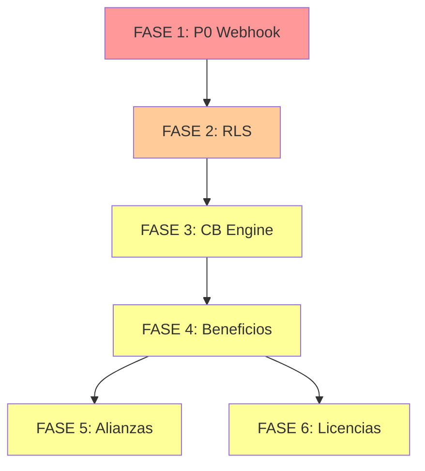

# Plan Técnico de Implementación Comercial

## FASE 0: ANÁLISIS PREVIO — Tablas a Reutilizar

### ✅ Tablas Completas (NO MODIFICAR)

| Tabla | Uso | Comentario |
|-------|-----|------------|
| `allies` | Base Alianzas | Usar directamente |
| `coach_ally_relationships` | Relación coach ↔ aliado | Usar directamente |
| `ally_operations` | Operaciones comerciales | Usar directamente |
| `ally_operation_items` | Items de operación | Usar directamente |
| `ally_payment_declarations` | Declaraciones de pago | Usar directamente |
| `ally_products`, `ally_services` | Catálogo aliado | Usar directamente |
| `commission_agreements` | Acuerdos de comisión | Usar directamente |
| `commission_entries` | Entradas de comisión | Usar directamente |
| `financial_adjustments` | Ajustes financieros | Usar directamente |
| `coach_settlements` | Liquidaciones | Usar directamente |
| `settlement_items` | Items liquidación | Usar directamente |

### ⚠️ Tablas con Discrepancia (REQUEREN ANÁLISIS)

| Tabla | Issue | Decisión requerida |
|-------|-------|-------------------|
| `athlete_memberships` | Faltan `license_state`, `license_condition` | ¿Agregar campos o crear tabla separada? |
| `membership_payments` | No existe en apps/api/migrations | ¿Crear tabla o usar `polar_order_id` como idempotencia? |
| `plans` | Diferente en Turso vs migraciones | Usar migraciones como fuente de verdad |

**DECISIÓN:** `athlete_memberships` y `membership_payments` son el **único punto de fricción**. Deben resolverse antes de Fase 4.

---

## FASE 1: P0 — Cola Durable de Mercado Pago

### 1.1 Tablas Nuevas Necesarias

#### `payment_events`
```sql
CREATE TABLE payment_events (
    id TEXT PRIMARY KEY,
    external_id TEXT NOT NULL UNIQUE,           -- MP payment id
    event_type TEXT NOT NULL,                    -- payment, merchant.order
    resource TEXT NOT NULL,                      -- payment
    status TEXT NOT NULL DEFAULT 'received',     -- received, processing, completed, failed
    raw_payload TEXT NOT NULL,                   -- JSON completo del webhook
    processed_at TEXT,                             -- TIMESTAMP cuando se procesó
    error_count INTEGER NOT NULL DEFAULT 0,
    last_error TEXT,
    created_at TEXT NOT NULL DEFAULT (datetime('now'))
);

CREATE UNIQUE INDEX idx_payment_events_ext ON payment_events(external_id);
CREATE INDEX idx_payment_events_status ON payment_events(status);
CREATE INDEX idx_payment_events_created ON payment_events(created_at);
```

#### `payment_work_queue`
```sql
CREATE TABLE payment_work_queue (
    id TEXT PRIMARY KEY,
    event_id TEXT NOT NULL REFERENCES payment_events(id) ON DELETE CASCADE,
    task_type TEXT NOT NULL,                     -- fulfill_membership, fulfill_order
    payload TEXT NOT NULL,                       -- JSON con datos necesarios
    status TEXT NOT NULL DEFAULT 'pending',      -- pending, processing, completed, failed
    attempt INTEGER NOT NULL DEFAULT 1,
    max_attempts INTEGER NOT NULL DEFAULT 3,
    next_attempt_at TEXT,                        -- para backoff
    error_message TEXT,
    created_at TEXT NOT NULL DEFAULT (datetime('now')),
    updated_at TEXT NOT NULL DEFAULT (datetime('now'))
);

CREATE INDEX idx_workqueue_status ON payment_work_queue(status);
CREATE INDEX idx_workqueue_next_attempt ON payment_work_queue(next_attempt_at);
```

### 1.2 Archivos Go a Modificar

| Archivo | Función | Cambio |
|---------|---------|--------|
| `handlers/payment.go` | `handleWebhook` | Persistir evento primero, luego encolar |
| `application/payment/service.go` | `ProcessWebhook` | Separar en: validate → persist → enqueue |
| `application/payment/service.go` | Nuevo método `EnqueueFulfillment()` | Crear |
| `domain/membership/repository.go` | Nuevo método | `ReconcilePendingPayments()` |

### 1.3 Flujo Durable

```
Mercado Pago Webhook
        ↓
[1] Verificar firma (YA EXISTE)
        ↓
[2] Persistir en payment_events (NUEVO)
        ↓
[3] Insertar en payment_work_queue (NUEVO)
        ↓
[4] Responder 200 a MP
        ↓
[5] Worker (cron o proceso separado) procesa cola
        ↓
[6] fetchPayment() → ActivateAfterPayment() (YA EXISTE)
        ↓
[7] Actualizar status en payment_events
```

### 1.4 Transacciones y Concurrencia

- `payment_events.id` es UUID, garantiza unicidad
- `payment_events.external_id` UNIQUE, previene duplicados
- Worker usa `UPDATE ... SET status='processing' WHERE status='pending' RETURNING *` para lock de fila
- Backoff: `next_attempt_at = created_at + (2^attempt * 60) seconds`

### 1.5 Conciliación de Pagos No Procesados

```go
// Job periódico: buscar pagos aprobados en MP sin procesar
func (r *Repository) ReconcilePendingPayments(ctx context.Context, since time.Time) error {
    // 1. Buscar payment_events con status='received' o 'failed' y created_at < hace 1h
    // 2. Para cada uno, consultar /v1/payments/{id} a MP
    // 3. Si aprobado, encolar; si rechazado, marcar como failed
}
```

---

## FASE 2: Seguridad Multi-Tenant

### 2.1 Políticas RLS

#### Activar RLS en PostgreSQL:
```sql
-- Cada tabla financiera necesita su política
ALTER TABLE commission_entries ENABLE ROW LEVEL SECURITY;
ALTER TABLE athlete_memberships ENABLE ROW LEVEL SECURITY;
ALTER TABLE coach_settlements ENABLE ROW LEVEL SECURITY;
```

#### Política de aislamiento por coach:
```sql
CREATE POLICY "coach_isolation_commission_entries"
ON commission_entries
FOR ALL TO PUBLIC
USING (
    coach_id = current_setting('app.current_user_id')::TEXT
    OR EXISTS (
        SELECT 1 FROM coach_ally_relationships car
        JOIN allies a ON car.ally_id = a.id
        WHERE car.coach_id = current_setting('app.current_user_id')::TEXT
        AND car.status = 'active'
        AND commission_entries.relationship_id = car.id
    )
);
```

#### Política Super Admin:
```sql
CREATE POLICY "super_admin_override"
ON commission_entries
FOR ALL USING (current_setting('app.user_role') = 'super_admin');
```

### 2.2 Contexto de Usuario

#### Modificar conexiones:
```go
// En infrastructure/db.go
func (c *Connection) SetUserContext(ctx context.Context, userID string, role string) error {
    _, err := c.db.ExecContext(ctx,
        "SET LOCAL app.current_user_id = $1, app.user_role = $2",
        userID, role)
    return err
}
```

### 2.3 RBAC — Tablas Nuevas

```sql
CREATE TABLE rbac_roles (
    id TEXT PRIMARY KEY,
    name TEXT NOT NULL UNIQUE,                   -- super_admin, coach_owner, coach_staff, athlete
    scope TEXT NOT NULL,                         -- global, organization, team
    permission_level INTEGER NOT NULL DEFAULT 0
);

CREATE TABLE rbac_permissions (
    id TEXT PRIMARY KEY,
    resource TEXT NOT NULL,                      -- commissions, exemptions, memberships
    action TEXT NOT NULL,                        -- read, write, admin, delete
    description TEXT
);

CREATE TABLE rbac_user_roles (
    user_id TEXT NOT NULL,
    role_id TEXT NOT NULL,
    scope TEXT NOT NULL,
    granted_by TEXT NOT NULL,
    granted_at TEXT NOT NULL DEFAULT (datetime('now')),
    PRIMARY KEY (user_id, role_id)
);
```

---

## FASE 3: Payment Events y Work Queue (P0)

### 3.1 Worker de Procesamiento

Patrón recomendado:
```go
type PaymentWorker struct {
    svc *Service
    db  *sql.DB
    mp  *MercadoPagoClient
}

func (w *PaymentWorker) ProcessNext(ctx context.Context) error {
    // LOCK fila disponible
    var job WorkQueueItem
    err := w.db.QueryRowContext(ctx, `
        UPDATE payment_work_queue 
        SET status='processing', attempt=attempt+1, updated_at=NOW()
        WHERE status='pending' AND attempt < max_attempts
        RETURNING id, event_id, task_type, payload
    `).Scan(&job.ID, &job.EventID, &job.TaskType, &job.Payload)
    
    if err == sql.ErrNoRows {
        return nil // no work
    }
    
    // Procesar
    err = w.processTask(ctx, &job)
    
    // Actualizar status
    if err != nil {
        w.db.ExecContext(ctx, 
            "UPDATE payment_work_queue SET status='failed', error_message=$1 WHERE id=$2",
            err.Error(), job.ID)
    } else {
        w.db.ExecContext(ctx,
            "UPDATE payment_work_queue SET status='completed', updated_at=NOW() WHERE id=$1",
            job.ID)
    }
    
    return err
}
```

### 3.2 Reintentos con Backoff Exponencial

- Intento 1: inmediato
- Intento 2: 1 minuto
- Intento 3: 8 minutos
- Máximo 3 intentos → alerta manual

---

## FASE 4: Commercial Policy Engine

### 4.1 Algoritmo de Resolución de Políticas

```go
func ResolveCommission(relationshipID, operationType, planName string) (rateBps, fixedAmountCents int, err error) {
    // 1. Excepción específica (más alta prioridad)
    // 2. Regla por coach
    // 3. Regla por plan
    // 4. Regla por tipo de operación
    // 5. Política global (default)
    
    // Cada paso usa la política activa en esa fecha
    // Si hay conflicto (múltiples reglas aplican), el ORDER por priority
}
```

### 4.2 Tablas Nuevas

| Tabla | Campos clave |
|-------|--------------|
| `commercial_policies` | id, name, default_rate_bps, default_fixed_amount_cents, currency, is_active |
| `policy_versions` | policy_id, version, rate_bps, fixed_amount_cents, valid_from, valid_to, status |
| `policy_rules_coach` | policy_id, coach_id, rate_bps, fixed_amount_cents, effective_from, effective_to |
| `policy_rules_plan` | policy_id, plan_name, rate_bps, fixed_amount_cents |
| `policy_rules_operation` | policy_id, operation_type, rate_bps, fixed_amount_cents |
| `policy_exceptions` | policy_id, exception_key, rate_bps, fixed_amount_cents, expires_at |

---

## FASE 5: Integración con Alianzas

### 5.1 Punto de Integración

`commission_entries` EXISTENTE ya tiene:
- `operation_id` → `ally_operations`
- `relationship_id` → `coach_ally_relationships`
- `agreement_id` → `commission_agreements`

**NO crear tablas duplicadas.** El motor comercial debe:
1. Leer `commission_entries` existente
2. Aplicar nuevas reglas de política
3. Generar snapshot en campo `policy_snapshot` (añadir columna)
4. Registrar ajustes en `financial_adjustments`

---

## FASE 6: Licencias y Comportamiento de Atletas

### Decisión arquitectónica

**Separar dos dimensiones:**

| Concepto |tabla| Propósito |
|----------|-----|-----------|
| Estado de licencia | `coach_licenses.license_state` | active, grace_period, suspended |
| Condición comercial | `coach_licenses.license_condition` | standard, exempted, discounted, bonused |

**NO modificar `athlete_memberships` automáticamente.**

Crear tabla nueva:
```sql
CREATE TABLE coach_licenses (
    id TEXT PRIMARY KEY,
    relationship_id TEXT NOT NULL REFERENCES coach_ally_relationships(id),
    license_state TEXT NOT NULL DEFAULT 'active',       -- active, grace_period, suspended
    license_condition TEXT NOT NULL DEFAULT 'standard', -- standard, exempted, discounted, bonused
    grace_period_days INTEGER NOT NULL DEFAULT 7,
    valid_from TEXT NOT NULL,
    valid_to TEXT,
    reason TEXT,
    created_at TEXT NOT NULL DEFAULT (datetime('now')),
    updated_at TEXT NOT NULL DEFAULT (datetime('now'))
);
```

---

## 📊 DEPENDENCIA ENTRE FASES



---

## 📋 CRITERIOS DE ACEPTACIÓN

| Fase | Criterio | Verificación |
|------|----------|--------------|
| 1 | Webhook responde 200 siempre | Test con payload inválido |
| 1 | Eventos se persisten antes de responder | Mock MP, verificar DB |
| 1 | Worker recupera después de restart | Crash test durante procesamiento |
| 2 | Coach no puede ver otros coach's data | Prueba con usuario diferente |
| 2 | Super Admin ve todo | Prueba con rol super_admin |
| 3 | Comisión correcta bajo 5 escenarios | Unit tests del motor |
| 4 | Aprobación dual funciona | Test de flujo con 2 usuarios |
| 5 | Liquidaciones sin duplicar | Comparar con datos existentes |
| 6 | Athlete access correcto | Test de estado por tipo de licencia |

---

## 🔄 ESTRATEGIA DE ROLLBACK

1. **Migration rollback:** `BEGIN; ... ROLLBACK;` hasta validar
2. **Datos existentes:** Nunca DELETE/UPDATE de datos financieros
3. **RLS:** DESABILITAR políticas antes de DROP de columnas
4. **Workers:** Verificar cola vacía antes de DROP de tablas
5. **Pruebas de integración:** Ejecutar contra base de QA primero